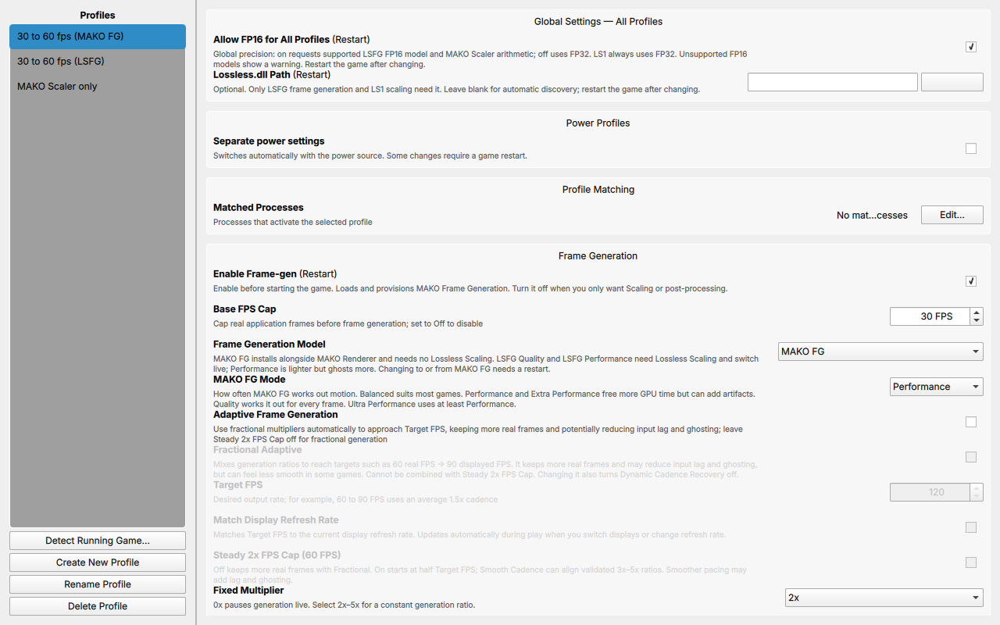
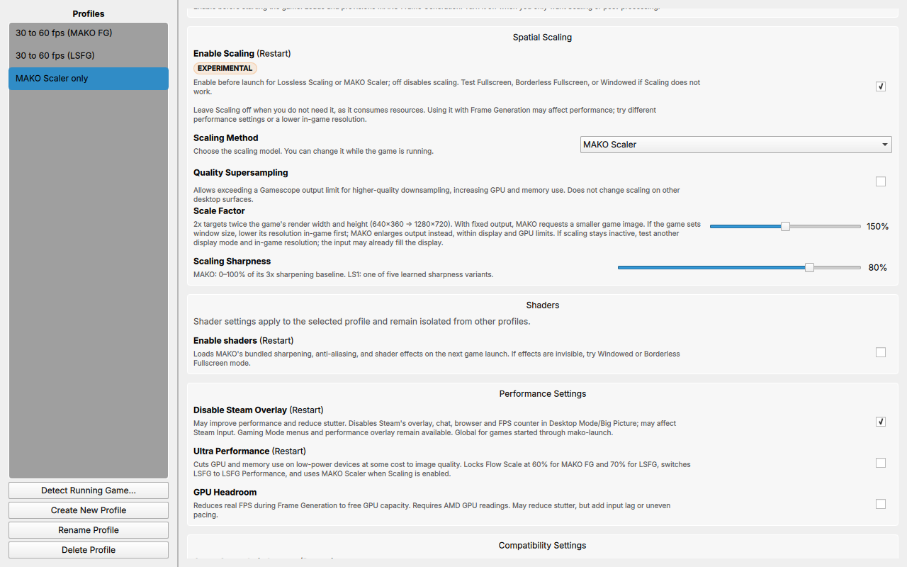

# mako-arm64

Run [MAKO](https://github.com/eugeniosegala/MAKO), the Vulkan layer that adds
frame generation and spatial scaling to Linux games, natively on Snapdragon
handhelds running [ArmadaOS](https://armadaos.dev/), such as the Retroid
Pocket 6.

<p align="center">
  
  
</p>

Upstream publishes MAKO for x86_64 hosts only, and its Decky plugin turns
itself off on ArmadaOS on purpose. This repository builds MAKO's own Renderer
from its source for aarch64 and packages it with upstream's installer, so the
standalone setup upstream documents for desktop Linux works on the handheld:
the Renderer goes into `~/.local`, MAKO Renderer Configuration (above) holds a
profile per game, and `mako-launch` in the game's Steam launch options turns
it on.

This is not an official MAKO release. Report problems here, not upstream.

## What works

The layer runs inside the game's process, so it serves games whose Vulkan runs
as aarch64: native ARM64 ports and games under Proton ARM64. x86 Linux games
that run whole under FEX keep their own x86 Vulkan stack and are left alone.

| Feature | On ArmadaOS |
| --- | --- |
| Frame generation, MAKO FG | Experimental. MAKO FG runs in a separate program that exists only for x86-64; it runs through FEX and reaches the GPU through ArmadaOS's host Vulkan thunk. |
| Frame generation, LSFG Quality and Performance | Native, inside the layer. Needs your own [Lossless Scaling](https://store.steampowered.com/app/993090/Lossless_Scaling/) from Steam, default public branch. |
| MAKO Scaler | Native. |
| LS1 scaling | Native, with Lossless Scaling as above. |
| Shaders (vkBasalt) | Not in this build yet. |
| MangoHud through `mako-launch` | Not yet: `mako-launch` looks for x86 MangoHud only. Steam's performance overlay in Game Mode is not affected. |
| MAKO Decky plugin | No. Upstream keeps it off on ArmadaOS. |

The Renderer is upstream's code unchanged; [`upstream.json`](upstream.json)
pins the MAKO commit and the MAKO FG release. 79 of upstream's 82 tests pass
on aarch64 in CI; the other three cover x86-only parts (MangoHud staging, the
x86_64 Steam streaming client, the Arch Linux package).

## Install

1. In **Desktop Mode**, download `MAKO-Renderer-v5.0.0-linux-arm64.tar.gz`
   from the [latest release](https://github.com/Ken5998/mako-arm64/releases/latest)
   and extract it.
2. Open **Install MAKO Renderer** in the extracted folder. It copies the
   Renderer into `~/.local`, which ArmadaOS updates leave alone, keeps your
   profiles, and opens **MAKO Renderer Configuration**.

Run a newer installer the same way to update. **Uninstall MAKO Renderer** in
the application menu, or `~/.local/bin/mako-installer --uninstall`, removes
it and keeps your profiles.

## Use it in a game

1. In Steam, open the game's **Properties > Launch Options**. ArmadaOS games
   start with `/usr/libexec/armada/armada-game-launch %command%`; put MAKO's
   launcher in front of it:

   ```text
   ~/.local/bin/mako-launch /usr/libexec/armada/armada-game-launch %command%
   ```

   ArmadaOS's launcher still runs after MAKO's, so the per-game FEX, Turnip
   and performance settings from Armada Control keep working.
2. In **MAKO Renderer Configuration**, create a profile and pick Frame
   Generation and Scaling for it. Start the game, press **Detect Running
   Game...** to match its process to the profile, then restart the game.
3. Start the game from Steam, in Game Mode or Desktop Mode: the handheld's
   controls reach the game only when Steam starts it.

For a quick test without a profile, MAKO's environment-only mode doubles the
frame rate with MAKO FG:

```text
MAKO_ENV=1 MAKO_MULTIPLIER=2 ~/.local/bin/mako-launch /usr/libexec/armada/armada-game-launch %command%
```

Add `MAKO_FRAME_GENERATION_MODEL=lossless-scaling` to try LSFG instead. The
other variables are listed in upstream's
[configuration reference](https://github.com/eugeniosegala/MAKO/blob/render-v5.0.0/engine/docs/CONFIGURATION-REFERENCE.md#environment-only-configuration).

## Tips for the Retroid Pocket 6

- The panel runs at a fixed 60 Hz, so aim for a steady 30 real fps and 2x
  (Base FPS Cap 30 in the profile), or 20 fps and 3x for heavy games.
- Interpolation holds back one real frame: about 33 ms at 30 fps. Most games
  feel fine; fast racing games can feel it.
- Leave the Quick Access frame limit and Decky LSFG-VK off for games that use
  MAKO. `mako-launch` already keeps the LSFG-VK layers out of the game.
- If the GPU is already busy, start with MAKO FG Mode **Performance**, then
  lower Flow Scale or turn on **Ultra Performance**.
- MAKO FG needs **Host Vulkan** on (the default) in Armada Control >
  Compatibility > Host Thunks for that game. If the game's log says
  `mako-fg-host and the game are using different graphics drivers` or
  `Unable to start mako-fg-host`, MAKO FG cannot run there: the game keeps its
  real frames, and LSFG is the way to go.

MAKO writes its lines, all starting with `MAKO Renderer:`, to the game's error
output. For Proton games add `PROTON_LOG=1` in front of the launch options to
get them in `~/steam-<appid>.log`.

## Building

`scripts/build.sh [OUT]` fetches the pinned MAKO source and Vulkan-Headers,
builds with upstream's packaging options (without the 32-bit layer), adds MAKO
FG from the pinned Hugging Face revision after checking every file's hash, and
writes `OUT/MAKO-Renderer-v<version>-linux-arm64.tar.gz`. It runs on Fedora 44
aarch64, ArmadaOS's base, with:

```sh
dnf install git curl tar gzip findutils binutils python3 clang cmake ninja-build \
  libstdc++-static libX11-devel libxcb-devel mesa-libGL-devel qt6-qtdeclarative-devel
```

`MAKO_TESTS=1` also runs upstream's tests. The layers link their own C++
runtime with hidden symbols, so they load into games that bring a different
libstdc++. Fixes to upstream code go in `patches/` and are applied in order.

CI builds on GitHub's aarch64 runners in a Fedora 44 container, runs
upstream's tests, installs the package with upstream's installer and runs
`vkcube` through `mako-launch`. The **Release** workflow publishes the version
in `VERSION`.

## Licences

This repository and MAKO are GPL-3.0-or-later. MAKO FG's model is
[CC BY-NC 4.0](https://creativecommons.org/licenses/by-nc/4.0/) ("MAKO FG by
Eugenio Segala") and its runtime is published by its author in binary form
only, which may be redistributed unmodified for non-commercial use: the
release carries both unmodified, with their licence and third-party notices,
for non-commercial use only. No Lossless Scaling file is included or needed
for MAKO FG and MAKO Scaler.
